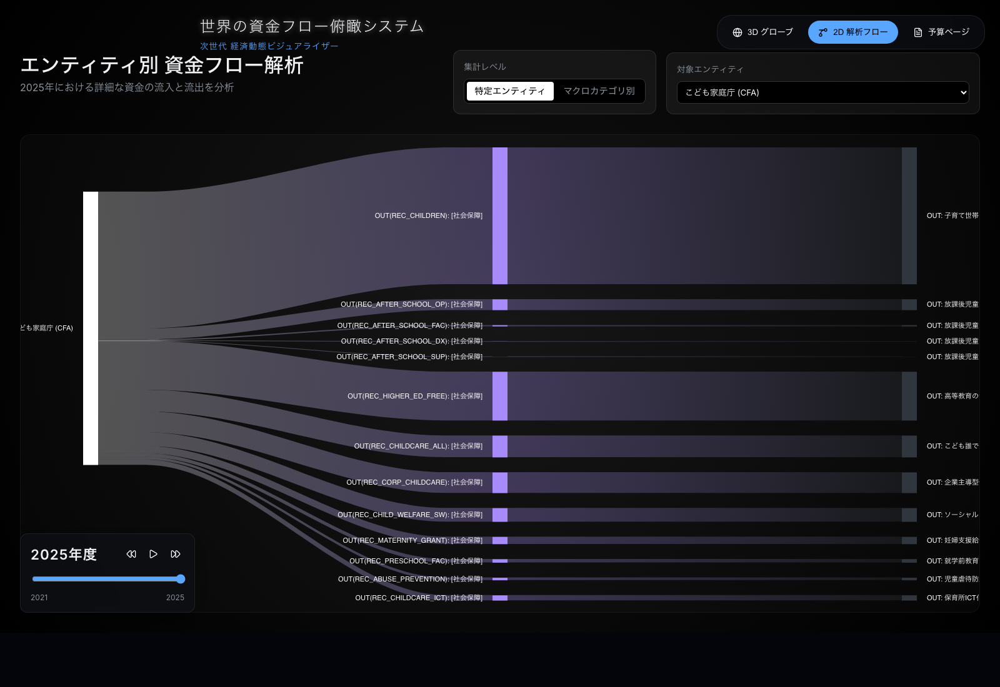
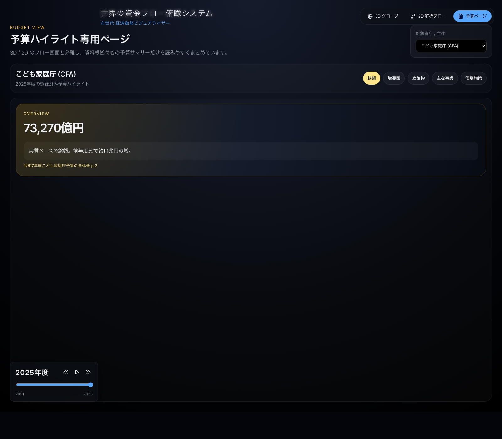

# Global Money Flow

日本の予算文書、政策 PDF、関連データを `RAG + フロー可視化 + 予算ページ` で横断的に扱うアプリです。文書をローカル embedding で検索しつつ、構造化した `source -> target -> amount` のフローを `3D / 2D / 予算ページ` で見られます。

## 何ができるか

- `RAG`: PDF / HTML / CSV / Excel を取り込み、引用付きで回答する
- `2D 解析フロー`: 特定主体の入出金と出典 PDF を見る
- `3D グローブ`: 年度ごとの大きな資金移動を俯瞰する
- `予算ページ`: 総額、増要因、政策枠、主要事業を一覧で読む
- `trusted ingest`: 信頼ドメインだけ自動 discovery / review / ingest / eval する

## 画面イメージ

### 2D 解析フロー



### 予算ページ



## 画面の使い分け

| 画面 | 向いている用途 |
| --- | --- |
| `3D グローブ` | 年度ごとの大きな資金移動を俯瞰したい |
| `2D 解析フロー` | 特定主体の入出金、hover の PDF 出典、ページ番号を追いたい |
| `予算ページ` | 省庁ごとの総額、増要因、政策枠、主要事業を読みたい |
| `RAG / MCP` | 文書群から引用付きで質問回答したい |

使い分けの詳細は [`docs/app_usage_guide.md`](/Volumes/space/お金の流れ/global-money-flow/docs/app_usage_guide.md) を参照してください。`RAG` と `フローDB` の違い、`公式PDF` と `推計配分` の見分け方、reviewed workflow の使い方を整理しています。

MEXT / MHLW のように official PDF から主要事業 edge を半自動で作る workflow は [`scripts/reviewed_budget_candidates/mext_r7_major_projects.json`](/Volumes/space/お金の流れ/global-money-flow/scripts/reviewed_budget_candidates/mext_r7_major_projects.json)、[`scripts/reviewed_budget_candidates/mhlw_r7_major_programs.json`](/Volumes/space/お金の流れ/global-money-flow/scripts/reviewed_budget_candidates/mhlw_r7_major_programs.json)、[`scripts/build_reviewed_budget_dataset.py`](/Volumes/space/お金の流れ/global-money-flow/scripts/build_reviewed_budget_dataset.py)、[`scripts/fetch_mext_budget.py`](/Volumes/space/お金の流れ/global-money-flow/scripts/fetch_mext_budget.py)、[`scripts/fetch_mhlw_budget.py`](/Volumes/space/お金の流れ/global-money-flow/scripts/fetch_mhlw_budget.py) にあります。Codex 用の運用手順は [`SKILL.md`](/Volumes/space/お金の流れ/global-money-flow/.codex/skills/ministry-budget-flow/SKILL.md) に切り出しました。

近い実装予定は [`docs/roadmap.md`](/Volumes/space/お金の流れ/global-money-flow/docs/roadmap.md) にまとめています。

## 最短セットアップ

```bash
python3 -m venv .venv
source .venv/bin/activate
python -m pip install -r scripts/requirements.txt
cp .env.example .env
ollama pull qwen2.5:3b
python3 scripts/seed_db.py
npm run build
```

`.env` の `EMBEDDING_MODEL_PATH` は自分のモデル配置先に合わせてください。

## Local RAG

現在の推奨構成は以下です。

- retrieval: `Qwen/Qwen3-Embedding-0.6B` を `transformers_local` で利用
- answer generation: `Ollama + qwen2.5:3b`
- DB: `data/money_flow.db`

実装仕様は [`docs/local_embedding_rag_architecture.md`](/Volumes/space/お金の流れ/global-money-flow/docs/local_embedding_rag_architecture.md) を参照してください。

## Setup

1. Python 依存を入れます。

```bash
python3 -m venv .venv
source .venv/bin/activate
python -m pip install -r scripts/requirements.txt
```

2. `.env` を作ります。

```bash
cp .env.example .env
```

3. `EMBEDDING_MODEL_PATH` を自分のモデル配置先に合わせます。

例:

```bash
EMBEDDING_MODEL_PATH=/Users/your-user/.cache/torch/sentence_transformers/Qwen_Qwen3-Embedding-0.6B
```

4. Ollama を起動し、推奨モデルを用意します。

```bash
ollama pull qwen2.5:3b
```

## Start

`.env` を読み込んで MCP server を起動するには以下を使います。

```bash
bash scripts/run_local_rag_server.sh
```

このスクリプトは次を確認します。

- `.env` の読み込み
- `EMBEDDING_MODEL_PATH` の存在
- `Ollama` API の到達性

## MCP Client Setup

### Claude Code

project root に [`.mcp.json`](/Volumes/space/お金の流れ/global-money-flow/.mcp.json) を追加してあります。Claude Code をこのディレクトリで開けば、project-scoped MCP server として `money-flow` を検出できます。

### Codex

Codex は user 設定に登録するので、以下を 1 回実行します。

```bash
bash scripts/setup_codex_mcp.sh
```

このスクリプトは既存の `money-flow` 設定があれば置き換えて、[`scripts/run_local_rag_server.sh`](/Volumes/space/お金の流れ/global-money-flow/scripts/run_local_rag_server.sh) を使う構成に更新します。

## Index Embeddings

既存文書の embedding を生成し直すには以下です。

```bash
source .venv/bin/activate
set -a
source .env
set +a
python scripts/index_local_embeddings.py --limit 20 --force
```

## Reviewed Budget Workflow

official ministry PDF から UI 用 edge を増やすときは次の順です。

```bash
python3 scripts/build_reviewed_budget_dataset.py \
  --input scripts/reviewed_budget_candidates/mext_r7_major_projects.json \
  --output src/data/mext_budget_data.json
python3 scripts/build_reviewed_budget_dataset.py \
  --input scripts/reviewed_budget_candidates/mhlw_r7_major_programs.json \
  --output src/data/mhlw_budget_data.json
python3 scripts/seed_db.py
npm run build
```

MEXT / MHLW の FY2025 主要事業はこの workflow で `MIN_MEXT -> REC_MEXT_*` と `MIN_MHLW -> REC_MHLW_*` edge、および `budget_highlights` に入っています。

## Query Examples

context pack だけ作る:

```bash
source .venv/bin/activate
set -a
source .env
set +a
python - <<'PY'
import json
import sys
sys.path.insert(0, 'scripts')
import mcp_server

conn = mcp_server.get_db()
try:
    result = mcp_server._answer_documents({
        'query': '児童手当 予算',
        'mode': 'hybrid',
        'limit': 3,
    }, conn)
    print(json.dumps(result, ensure_ascii=False, indent=2))
finally:
    conn.close()
PY
```

最終回答まで生成する:

```bash
source .venv/bin/activate
set -a
source .env
set +a
python - <<'PY'
import json
import sys
sys.path.insert(0, 'scripts')
import mcp_server

conn = mcp_server.get_db()
try:
    result = mcp_server._generate_document_answer({
        'query': '児童手当の予算について要点を教えてください',
        'mode': 'hybrid',
        'limit': 2,
    }, conn)
    print(json.dumps(result, ensure_ascii=False, indent=2))
finally:
    conn.close()
PY
```

## Eval

代表質問セットをまとめて評価するには以下です。

```bash
source .venv/bin/activate
python scripts/run_rag_eval.py
```

出力先:

- `eval/latest_results.json`
- `eval/latest_report.md`

質問セットは [`eval/questions.json`](/Volumes/space/お金の流れ/global-money-flow/eval/questions.json) を編集します。

## Trusted Source Flow

自動 ingest は、検索結果をそのまま取り込むのではなく、`discovery` と `execution` を分けて運用します。

1. 検索エンジンと LLM で候補 URL を見つける
2. 候補を `source_candidates` 相当のキューに入れる
3. review 済みのルールだけを `source_policies` に昇格させる
4. `source_policies` に一致した URL だけ `crawl_url -> embedding -> eval` に流す

推奨 tier:

- `tier_a_auto`
  - 省庁の予算 PDF や主要施策 PDF
- `tier_b_review`
  - 自治体サイトや関連団体
- `tier_c_block`
  - ニュース、ブログ、転載、検索結果ページ

対応する MCP ツール:

- `register_source_candidate`
- `list_source_candidates`
- `review_source_candidates_report`
- `bulk_review_source_candidates`
- `discover_source_candidates_by_search`
- `discover_source_candidates_from_page`
- `approve_source_candidate`
- `register_source_policy`
- `list_source_policies`
- `check_source_policy`
- `crawl_trusted_url`
- `bulk_ingest_trusted_candidates`
- `ingest_and_eval_trusted_candidates`
- `daily_trusted_ingest_pipeline`

gate の使い方:

1. `check_source_policy` で URL の `allow_auto_ingest / review_required / blocked / no_policy` を確認する
2. `allow_auto_ingest` の URL だけ `crawl_trusted_url` に流す
3. `no_policy` や `no_matching_policy` は `register_candidate_if_denied=true` で candidate に送る

discovery の使い分け:

- `discover_source_candidates_by_search`
  - Bing RSS を使って候補 URL を探す
  - 新規ドメインや一覧ページの発見に使う
- `discover_source_candidates_from_page`
  - 公式一覧ページの `main/article` からリンクを抽出する
  - 予算 PDF や資料リンクの収集はこちらを主経路にする

review の使い方:

- `review_source_candidates_report`
  - pending candidate を domain ごとにまとめる
  - `approve_tier_a_auto / approve_tier_b_review / manual_review / block_tier_c / already_covered` を返す
  - `suggested_approval_args` をそのまま `approve_source_candidate` に渡せる
- `bulk_review_source_candidates`
  - report の recommendation をまとめて適用する
  - 既定では `dry_run=true`
  - `manual_review` は自動適用しない
- `bulk_ingest_trusted_candidates`
  - `approved` candidate のうち `allow_auto_ingest` に一致した URL を一括 ingest する
  - 既定では `dry_run=true`
  - 実処理は内部で `crawl_trusted_url` を使う
- `ingest_and_eval_trusted_candidates`
  - ingest の後に `eval/questions.json` の評価を続けて実行する
  - 既定では `dry_run=true`
  - `eval/latest_results.json` と `eval/latest_report.md` まで更新できる
- `daily_trusted_ingest_pipeline`
  - discovery から eval までを 1 ドメイン単位でまとめて実行する
  - 既定では `dry_run=true`
  - 実行ログを JSON で残せる

例:

```json
{
  "tool": "discover_source_candidates_from_page",
  "arguments": {
    "url": "https://www.cfa.go.jp/policies/budget/",
    "same_domain_only": true,
    "file_types": ["pdf", "html"],
    "limit": 20,
    "register_candidates": true
  }
}
```

```json
{
  "tool": "review_source_candidates_report",
  "arguments": {
    "review_status": "pending",
    "domain": "cfa.go.jp",
    "limit": 20,
    "include_markdown": true
  }
}
```

```json
{
  "tool": "bulk_review_source_candidates",
  "arguments": {
    "domain": "cfa.go.jp",
    "recommendation_filter": ["approve_tier_a_auto", "block_tier_c"],
    "dry_run": true
  }
}
```

```json
{
  "tool": "bulk_ingest_trusted_candidates",
  "arguments": {
    "domain": "cfa.go.jp",
    "candidate_review_status": "approved",
    "dry_run": true
  }
}
```

```json
{
  "tool": "ingest_and_eval_trusted_candidates",
  "arguments": {
    "domain": "cfa.go.jp",
    "candidate_review_status": "approved",
    "eval_sample": 3,
    "dry_run": true
  }
}
```

```json
{
  "tool": "daily_trusted_ingest_pipeline",
  "arguments": {
    "listing_page_urls": ["https://www.cfa.go.jp/policies/budget/"],
    "allowed_domains": ["cfa.go.jp"],
    "eval_sample": 3,
    "dry_run": true
  }
}
```

CLI から回す場合:

```bash
source .venv/bin/activate
python scripts/run_daily_trusted_ingest_pipeline.py \
  --listing-page-url https://www.cfa.go.jp/policies/budget/ \
  --allowed-domain cfa.go.jp \
  --eval-sample 3
```

shell wrapper から回す場合:

```bash
bash scripts/run_daily_trusted_ingest_pipeline.sh \
  --listing-page-url https://www.cfa.go.jp/policies/budget/ \
  --allowed-domain cfa.go.jp \
  --eval-sample 3
```

本実行する場合:

```bash
source .venv/bin/activate
python scripts/run_daily_trusted_ingest_pipeline.py \
  --listing-page-url https://www.cfa.go.jp/policies/budget/ \
  --allowed-domain cfa.go.jp \
  --eval-sample 3 \
  --apply
```

shell wrapper は `.env` を読み込み、`PYTHON_BIN` 未指定なら `./.venv/bin/python` を優先します。`launchd` や cron からは shell wrapper を使う方が安全です。

quality gate:

- `--apply` 時は eval quality gate が有効です
- 既定では `pass_rate >= 100.0`、`failed_questions <= 0`、`ingest_error_count <= 0` を要求します
- 新規 ingest が 0 件だった日は `quality_gate.status = not_applicable` となり、失敗扱いにはしません
- quality gate が fail した場合、CLI は exit code `1` を返します
- 必要なら `--quality-gate-min-pass-rate`、`--quality-gate-max-failed-questions`、`--quality-gate-max-fallback-used`、`--quality-gate-max-ingest-errors` で閾値を調整できます
- 一時的に止めたい場合だけ `--disable-quality-gate` を使います

macOS `launchd` で日次実行する場合:

1. `ops/launchd/io.global-money-flow.daily-pipeline.plist.example` の `__REPO_ROOT__` を実パスへ置換する
2. `cp ops/launchd/io.global-money-flow.daily-pipeline.plist.example ~/Library/LaunchAgents/io.global-money-flow.daily-pipeline.plist`
3. `plutil -lint ~/Library/LaunchAgents/io.global-money-flow.daily-pipeline.plist`
4. `launchctl bootstrap "gui/$(id -u)" ~/Library/LaunchAgents/io.global-money-flow.daily-pipeline.plist`

`--apply` を plist に足すのは dry-run の確認後にしてください。標準出力と標準エラーは `eval/daily_pipeline.stdout.log` と `eval/daily_pipeline.stderr.log` に出ます。

詳細仕様は [`docs/local_embedding_rag_architecture.md`](/Volumes/space/お金の流れ/global-money-flow/docs/local_embedding_rag_architecture.md) の `15. 信頼ソース選定フロー` を参照してください。

## Notes

- `qwen2.5:3b` はローカル検証で引用番号付き回答を返しました。
- `qwen2.5:1.5b` は軽いですが、引用番号を落としやすいです。
- `qwen2.5:7b` は重いので、他モデルとの並列実行は避けてください。
- `generate_document_answer` は引用番号が無い回答を検知すると、既定で 1 回だけ厳格な再生成を行います。必要なら `ANSWER_CITATION_RETRY_LIMIT` で調整できます。
- 再生成でも引用番号が無い場合は、取得済み context の citation id を各文へ補完し、短い箇条書きに整形して warning を返します。
- fallback 整形では、query と citation から抽出した focus term、数値、予算関連語を優先し、汎用的な説明文は後ろに回します。
- `内数`、`特別会計`、`○○庁予算` のような文書メタ寄りの語は focus term から除外します。
- query に応じて `childcare` / `higher_education` / `youth_support` の theme rule を切り替え、他テーマ語を blacklist します。
- fallback 箇条書きの文数は `ANSWER_CITATION_FALLBACK_MAX_SENTENCES` で調整できます。
- fallback が動いた場合は、`answer_generation.citation_fallback_format.focus_terms` と `themes` に選別根拠が入ります。
- モデル本体は Git に入れず、repo 外か外部 SSD に置いてください。
