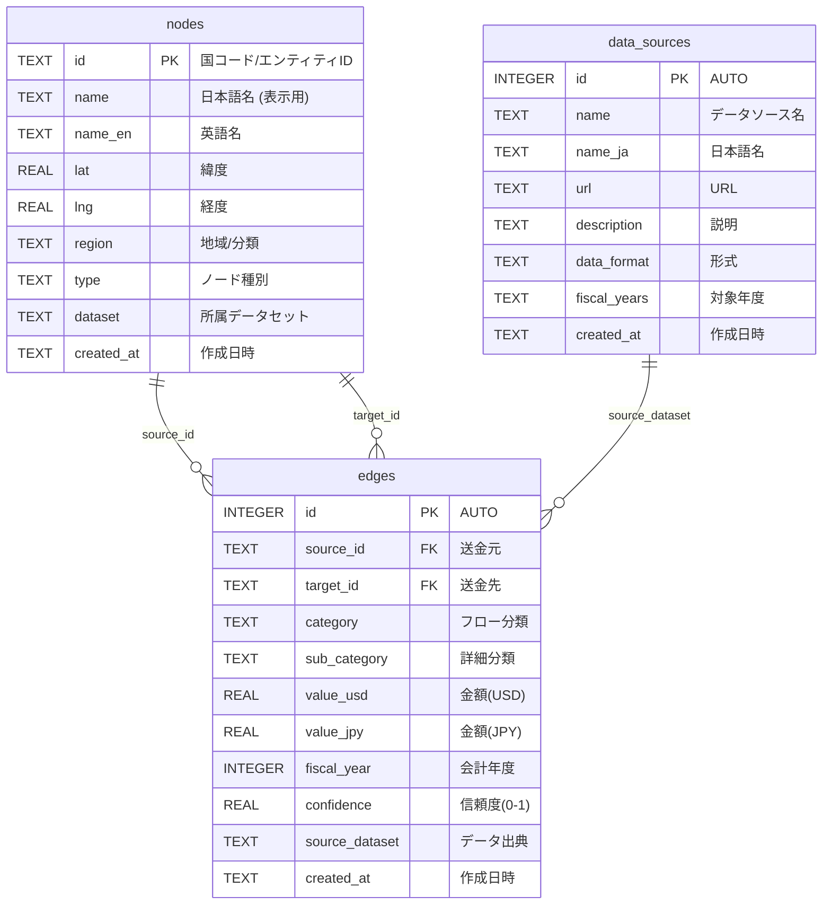

# Database Schema Documentation
# money_flow.db (SQLite)

> 日本の資金フロー可視化プロジェクトのマスターデータベース

---

## ER図



---

## テーブル定義

### `nodes` — エンティティマスタ

| カラム | 型 | 説明 | 例 |
|--------|------|------|------|
| `id` | TEXT PK | 一意ID | `JPN`, `EXP_SOCIAL`, `REC_HOSPITAL` |
| `name` | TEXT | 表示名 | `日本`, `社会保障関係費` |
| `name_en` | TEXT | 英語名 | `Japan`, `Social Security` |
| `type` | TEXT | ノード種別 | 下記参照 |
| `dataset` | TEXT | 所属データセット | `real_data`, `mhlw_data` |

#### ノード種別 (`type`)

| type | 説明 | ノード数 |
|------|------|---------|
| `country` | 国家 | 19 |
| `recipient` | 受給者/産業 | 14 |
| `mof_expenditure` | 国庫歳出 | 7 |
| `mof_revenue` | 国庫歳入 | 6 |
| `mhlw_benefit` | 社会保障制度 | 5 |
| `prefecture` | 都道府県 | 5 |
| `individual` | 個人/属性 | 4 |
| `macro_entity` | マクロ主体 | 4 |
| `corporation` | グローバル企業 | 3 |
| `corporation_jp` | 国内企業 | 3 |

---

### `edges` — 資金フロー

| カラム | 型 | 説明 |
|--------|------|------|
| `source_id` | TEXT FK | 送金元ノードID |
| `target_id` | TEXT FK | 送金先ノードID |
| `category` | TEXT | フロー分類 |
| `value_usd` | REAL | 金額 (USD) |
| `value_jpy` | REAL | 金額 (JPY, 1$=150円) |
| `fiscal_year` | INTEGER | 会計年度 (2021-2024) |
| `confidence` | REAL | 信頼度 (0.0-1.0) |
| `source_dataset` | TEXT | データ出典名 |

#### カテゴリ (`category`)

| category | 日本語 | エッジ数 | 合計金額 |
|----------|--------|---------|---------|
| `trade` | 貿易 | 386 | $11.9T |
| `bop` | 国際収支 | 36 | $6.0T |
| `remittance` | 送金/給付 | 116 | $1.3T |
| `banking` | 銀行 | 12 | $1.2T |
| `welfare` | 社会保障 | 20 | $961B |
| `crypto` | 暗号資産 | 8 | $128B |

---

### `data_sources` — データソース登録

10件の公式データソースを登録済み：

| # | データソース | 形式 |
|---|------------|------|
| 1 | IMF DOTS (貿易統計) | API/JSON |
| 2 | World Bank (個人送金) | API/JSON |
| 3 | 日本銀行 資金循環統計 | Excel/CSV |
| 4 | 財務省 一般会計予算 | PDF/Excel |
| 5 | 厚生労働省 国民医療費 | Excel |
| 6 | 厚生労働省 介護給付費 | Excel |
| 7 | こども家庭庁 予算概要 | PDF |
| 8 | 参議院 社会保障関係予算 | PDF |
| 9 | IPSS 社会保障費用統計 | Excel/CSV |
| 10 | e-Stat API | API/JSON/CSV |

---

## 利用方法

```bash
# 1. DB初期化
python scripts/init_db.py

# 2. JSONデータ投入
python scripts/seed_db.py

# 3. DBファイルの場所
data/money_flow.db

# 4. フロントエンド用JSON
src/data/unified_data.json
```

## クエリ例

```sql
-- 社会保障関連の全フロー (FY2024)
SELECT n1.name AS "送金元", n2.name AS "送金先", 
       ROUND(e.value_jpy / 1e12, 2) AS "兆円"
FROM edges e
JOIN nodes n1 ON e.source_id = n1.id
JOIN nodes n2 ON e.target_id = n2.id
WHERE e.category = 'welfare' AND e.fiscal_year = 2024
ORDER BY e.value_usd DESC;

-- ノード種別ごとの集計
SELECT type, COUNT(*) FROM nodes GROUP BY type ORDER BY COUNT(*) DESC;

-- 年度別の総フロー額
SELECT fiscal_year, ROUND(SUM(value_usd)/1e9, 1) AS "BillionUSD"
FROM edges GROUP BY fiscal_year;
```
