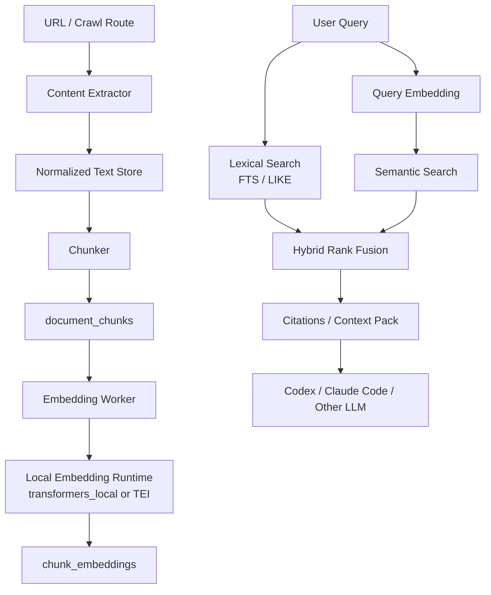
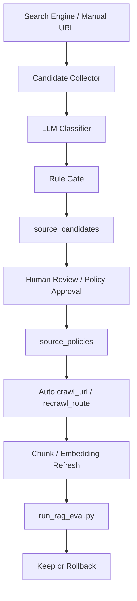

# ローカル Embedding RAG 実装仕様

> 対象モデル: `Qwen/Qwen3-Embedding-0.6B`
> 対象環境: macOS (Apple Silicon 優先), SQLite, Python MCP server

## 1. 目的

本プロジェクトの既存 SQLite / MCP 構成を維持しつつ、`Gemini API` や `OpenAI Embeddings API` に依存しないローカル RAG 基盤を追加する。

今回の設計では、生成モデルそのものをバックエンドに固定しない。バックエンドは以下を担当する。

- 文書取得
- 正規化
- チャンク化
- ローカル embedding 生成
- ハイブリッド検索
- 出典付きコンテキスト返却

回答生成は将来的に `Codex` / `Claude Code` / 別の LLM から利用できるようにし、検索基盤と分離する。

## 2. 前提

現状のシステムは次の特徴を持つ。

- 文書取得とチャンク保存は `scripts/mcp_server.py` で実施している
- 検索は `document_chunks` に対する `LIKE` ベースであり、意味検索は未実装
- `document_chunks_fts` は存在するが、日本語検索では未活用
- `crawl_url` は取得文書を保存するが、再クロール時の再索引は未整備

このため、現状は「軽量全文検索」であり、「embedding を使った RAG」ではない。

## 3. スコープ

今回の実装対象:

- ローカル embedding 実行基盤の追加
- 文書全文保存と再索引フローの整備
- embedding 保存テーブルの追加
- semantic / lexical / hybrid 検索の追加
- 出典付き検索結果を返す MCP API の定義
- macOS ローカル実行前提の運用仕様

今回の実装対象外:

- OpenClaw 組み込み
- 会話用ローカル LLM の常設
- chunk reranker の追加
- multi-vector retrieval
- OCR パイプラインの高度化

## 4. 推奨アーキテクチャ



設計上の重要点:

- embedding は検索専用コンポーネントとして分離する
- 生成モデルはバックエンドに組み込まない
- SQLite は引き続き正本 DB とする
- embedding サーバーはローカル別プロセスで稼働させる
- 再クロール時はチャンクと embedding を再生成する

## 5. コンポーネント設計

### 5.1 Content Extractor

役割:

- HTML / PDF / CSV / Excel から可視テキストを抽出
- 検索用の `normalized_text` を生成
- 文書メタデータを `crawl_documents` に保存

方針:

- `crawl_url` と `recrawl_route` で同じ抽出処理を使う
- truncation はレスポンス表示のみに適用し、DB には全文を保存する
- 検索インデックス生成前に本文を短くしない
- 同一 `source_url + content_hash` の文書は再利用し、無駄な重複保存を避ける

### 5.2 Chunker

役割:

- `normalized_text` から検索用チャンクを生成

推奨仕様:

- PDF:
  - 1ページ = 1チャンクを基本
  - 長すぎる場合のみ 800〜1200 文字で再分割
- HTML / text:
  - 段落ベース優先
  - fallback は文字数ベース

初期パラメータ:

- `chunk_target_chars`: 1000
- `chunk_max_chars`: 1400
- `chunk_overlap_chars`: 150
- `min_chunk_chars`: 80

### 5.3 Local Embedding Server

役割:

- chunk と query の embedding を返す

推奨モデル:

- `Qwen/Qwen3-Embedding-0.6B`

推奨実行方式:

- 第1候補: `transformers` 直呼び (`transformers_local`)
- 第2候補: Hugging Face `text-embeddings-inference` (`tei_local`)

初期設定:

- `EMBEDDING_PROVIDER=transformers_local`
- `EMBEDDING_MODEL=Qwen/Qwen3-Embedding-0.6B`
- `EMBEDDING_MODEL_PATH=/Volumes/<external-ssd>/models/qwen3-embedding-0.6b` または空
- `EMBEDDING_ENDPOINT=http://127.0.0.1:8080`
- `EMBEDDING_DIM=1024`
- `EMBEDDING_TIMEOUT_SECONDS=30`
- `EMBEDDING_DEVICE=auto`
- `EMBEDDING_BATCH_SIZE=8`
- `EMBEDDING_MAX_LENGTH=8192`

補足:

- `transformers_local` は Apple Silicon Mac で追加プロセスなしに動かせる
- `tei_local` は別プロセス運用と HTTP 越しの疎結合が必要な場合に使う
- `Qwen3-Embedding-0.6B` は `transformers>=4.51.0` が必要
- 当面の実運用依存は `transformers<5` と `numpy<2` を推奨する

### 5.4 Retrieval Engine

検索方式:

- lexical search
  - 既存の `LIKE` を維持
  - 将来的には日本語トークナイザ付き FTS に置換可能
- semantic search
  - query embedding と chunk embedding の cosine similarity
- hybrid search
  - lexical 上位 N 件 + semantic 上位 N 件を統合
  - 初期は `RRF (Reciprocal Rank Fusion)` を採用
  - 同一 `source_url + page_number + chunk_index + content` は 1 件に正規化する

初期パラメータ:

- `lexical_top_k=20`
- `semantic_top_k=20`
- `final_top_k=8`
- `rrf_k=60`

### 5.5 Context Pack Builder

役割:

- LLM に渡す文脈を組み立てる
- 出典 URL / ページ番号 / chunk index を明示する

返却形式の原則:

- `source_url`
- `file_name`
- `page_number`
- `chunk_index`
- `score`
- `retrieval_mode`
- `snippet`

## 6. データモデル変更

### 6.1 既存テーブルの扱い

既存:

- `crawl_documents`
- `document_chunks`
- `document_chunks_fts`

改善方針:

- `crawl_documents.normalized_text` を必ず埋める
- `document_chunks` は再クロールごとに再生成可能にする

### 6.2 新規テーブル

```sql
CREATE TABLE IF NOT EXISTS chunk_embeddings (
  chunk_id         INTEGER PRIMARY KEY REFERENCES document_chunks(id) ON DELETE CASCADE,
  model_name       TEXT NOT NULL,
  embedding_dim    INTEGER NOT NULL,
  embedding_blob   BLOB NOT NULL,
  content_hash     TEXT NOT NULL,
  created_at       TEXT DEFAULT (datetime('now')),
  updated_at       TEXT DEFAULT (datetime('now'))
);

CREATE INDEX IF NOT EXISTS idx_chunk_embeddings_model
  ON chunk_embeddings(model_name);
```

補足:

- `embedding_blob` は `float32` 配列をバイナリで保存する
- JSON 保存はデバッグ性は高いが容量効率が悪いため採用しない
- `content_hash` により stale embedding を判定する

### 6.3 オプションの運用テーブル

必要であれば次を追加する。

```sql
CREATE TABLE IF NOT EXISTS embedding_jobs (
  id              INTEGER PRIMARY KEY AUTOINCREMENT,
  document_id     INTEGER REFERENCES crawl_documents(id) ON DELETE CASCADE,
  model_name      TEXT NOT NULL,
  status          TEXT NOT NULL,
  error_message   TEXT,
  started_at      TEXT,
  finished_at     TEXT,
  created_at      TEXT DEFAULT (datetime('now'))
);
```

このテーブルは並列実行や失敗再試行が必要になってから追加してもよい。初期実装では省略可能。

## 7. API / MCP 仕様

### 7.1 既存 API の変更

#### `crawl_url`

変更点:

- `crawl_documents.normalized_text` に全文を保存する
- `document_chunks` を共通 chunker で生成する
- オプションで embedding 生成を起動する

推奨追加引数:

- `index_embeddings: boolean = true`
- `reindex_if_exists: boolean = false`

#### `recrawl_route`

変更点:

- 再クロール後に該当文書の古い chunk を削除する
- 新しい chunk を再生成する
- 既存 embedding を削除または上書きする
- 必要なら `last_values` 更新を行う

#### `search_documents`

変更点:

- 検索モードを追加する

推奨引数:

- `query: string`
- `limit: integer = 10`
- `mode: "lexical" | "semantic" | "hybrid" = "hybrid"`
- `document_id: integer | null`

推奨レスポンス:

```json
{
  "query": "児童手当 予算",
  "mode": "hybrid",
  "count": 3,
  "results": [
    {
      "document_id": 7,
      "source_url": "https://...",
      "file_name": "20250306_policies_budget_63.pdf",
      "page_number": 14,
      "chunk_index": 14,
      "retrieval_mode": "hybrid",
      "score": 0.913,
      "snippet": "令和7年度予算案..."
    }
  ]
}
```

### 7.2 新規 API

#### `index_document_embeddings`

用途:

- 既存 document / chunk に対して embedding を再生成する

引数:

- `document_id: integer | null`
- `limit: integer | null`
- `force: boolean = false`

#### `answer_documents`

用途:

- 検索とコンテキスト整形のみを担当する
- 回答文の最終生成は別の LLM に委ねる
- 引用付き `context_text` と `answer_prompt` を返す

推奨引数:

- `query: string`
- `limit: integer = 5`
- `mode: "lexical" | "semantic" | "hybrid" = "hybrid"`
- `document_id: integer | null`
- `max_context_chars: integer = 6000`
- `max_chunk_chars: integer = 1200`

推奨レスポンス:

```json
{
  "query": "児童手当 予算",
  "mode": "hybrid",
  "citation_count": 2,
  "citations": [
    {
      "citation_id": "[1]",
      "file_name": "20241227_policies_budget_53.pdf",
      "page_number": 2,
      "chunk_index": 2,
      "source_url": "https://...",
      "content": "予算の総額は..."
    }
  ],
  "context_text": "[1] 20241227_policies_budget_53.pdf p.2 chunk 2 ...",
  "answer_prompt": "以下の context だけを根拠に..."
}
```

#### `generate_document_answer`

用途:

- `answer_documents` の context pack を使って最終回答を生成する
- 生成は `ollama` または OpenAI 互換 endpoint に委ねる

推奨引数:

- `query: string`
- `limit: integer = 5`
- `mode: "lexical" | "semantic" | "hybrid" = "hybrid"`
- `document_id: integer | null`
- `max_context_chars: integer = 6000`
- `max_chunk_chars: integer = 1200`
- `provider: "ollama" | "openai_compatible" | null`
- `model: string | null`
- `temperature: number | null`
- `max_output_tokens: integer | null`
- `citation_retry_limit: integer | null`

環境変数:

- `ANSWER_LLM_PROVIDER=ollama`
- `ANSWER_LLM_MODEL=qwen2.5:3b`
- `ANSWER_LLM_API_BASE=http://127.0.0.1:11434`
- `ANSWER_CITATION_RETRY_LIMIT=1`
- `ANSWER_CITATION_FALLBACK_MAX_SENTENCES=3`

補足:

- `provider` / `model` を引数で渡さない場合は環境変数を使う
- provider 未設定時は context pack のみ返し、回答生成は skip する
- `qwen2.5:3b` はローカル検証で `[1]` の引用を返した
- `qwen2.5:1.5b` は回答自体は生成できるが、引用番号を落としやすい
- `qwen2.5:7b` はメモリ負荷が高く、他モデルとの並列実行は避ける
- 引用番号が 1 つも無い回答は既定で 1 回だけ再生成し、`answer_generation.citation_attempts` に試行履歴を残す
- 再生成でも引用番号が無い場合は、取得済み context の `citation_id` を各文へ付与し、短い箇条書きに整形したうえで `answer_generation.citation_fallback` と warning を返す
- fallback 箇条書きは、query と citation から抽出した focus term、数値・金額・予算関連キーワードを含む文を優先し、汎用的な説明文は低優先にする
- `内数`、`特別会計`、`○○庁予算` のような文書メタ寄り語は focus term の blacklist で除外する
- query テーマに応じて `childcare` / `higher_education` / `youth_support` の blacklist を切り替える
- fallback の整形情報は `answer_generation.citation_fallback_format` に入り、`focus_terms` と `themes` で使用語を追跡できる

## 8. 検索アルゴリズム仕様

### 8.1 Lexical Search

初期実装:

- 既存の `LIKE` ベースを維持
- 日本語はスペース区切り AND 検索

将来案:

- SQLite FTS5 + 日本語トークナイザ
- trigram index

### 8.2 Semantic Search

query と chunk を同じモデルで embedding し、cosine similarity を計算する。

計算方法:

```text
score = dot(query_vec, chunk_vec) / (||query_vec|| * ||chunk_vec||)
```

初期実装方針:

- chunk 数が小さい間は SQLite から全 embedding を読んで Python 側で計算
- chunk 数が 10,000 を超えたら ANN 導入を再検討

### 8.3 Hybrid Search

`RRF` を使用する。

```text
RRF(d) = sum(1 / (k + rank_i(d)))
```

理由:

- lexical と semantic のスコア尺度を揃える必要がない
- 実装が簡単
- PoC での安定性が高い

## 9. macOS 運用仕様

### 9.1 対象

優先対象:

- Apple Silicon Mac

サポート対象:

- Intel Mac

運用方針:

- Apple Silicon は `transformers_local + MPS` を優先
- `tei_local` は必要な場合のみ採用する
- Intel は CPU fallback とする

### 9.2 ローカル実行構成

常駐プロセス:

- `transformers_local` の場合:
  - `scripts/mcp_server.py`
- `tei_local` の場合:
  - `scripts/mcp_server.py`
  - `text-embeddings-inference` サーバー

想定ポート:

- `MCP`: stdio
- `TEI`: `127.0.0.1:8080` (`tei_local` 使用時のみ)

### 9.3 リソース目安

初期想定:

- Apple Silicon 16GB メモリで開発可能
- embedding のみなら GPU は必須ではない
- 同時に大規模 chat model をローカル運用する場合は別途検討

### 9.4 モデル配置方針

原則:

- モデル本体は Git リポジトリに含めない
- モデル本体は repo 外に配置する
- 第1候補は Hugging Face キャッシュを利用する
- 容量制約がある場合は外部 SSD への配置を許容する

推奨配置先:

- `~/.cache/huggingface/`
- `~/models/qwen3-embedding-0.6b/`
- `/Volumes/<external-ssd>/models/qwen3-embedding-0.6b/`

運用ルール:

- Git に push するのはコード、設定、ドキュメントのみ
- モデル重み、HF キャッシュ、TEI のダウンロード済みアセットは push しない
- `EMBEDDING_MODEL_PATH` を使う場合は外部 SSD 上の固定パスを `.env` 等で指定する
- リポジトリ配下にモデルを置く場合でも `.gitignore` に含める
- 可能であればモデルは repo 配下に置かない

理由:

- モデルサイズが大きく Git 管理に向かない
- clone / pull が重くなる
- 複数プロジェクトでモデルを共有しにくくなる
- 外部 SSD やユーザーキャッシュ配下の方が運用しやすい

環境変数例:

```bash
export EMBEDDING_MODEL=Qwen/Qwen3-Embedding-0.6B
export EMBEDDING_ENDPOINT=http://127.0.0.1:8080
export HF_HOME=/Volumes/SSD_AI/huggingface
export HUGGINGFACE_HUB_CACHE=/Volumes/SSD_AI/huggingface/hub
```

明示的なローカルパスを使う場合の例:

```bash
export EMBEDDING_MODEL_PATH=/Volumes/SSD_AI/models/qwen3-embedding-0.6b
```

補足:

- 外部 SSD 配置は許容する
- ただしマウントパスが固定であることを前提にする
- 起動時に SSD が未マウントだと embedding サーバー起動に失敗する

## 10. 実装フェーズ

### Phase 1: 索引基盤の修正

- `crawl_url` の全文保存
- 共通 chunker 実装
- `recrawl_route` の再索引対応
- `search_documents` のレスポンス改善

完了条件:

- 既存文書の再クロールで `document_chunks` が更新される
- 省庁 PDF が全文検索可能になる

### Phase 2: embedding 基盤追加

- `chunk_embeddings` テーブル追加
- TEI client 実装
- query / chunk embedding 実装
- semantic search 追加

完了条件:

- 単独 semantic search が動作する
- embedding 再生成が可能

### Phase 3: hybrid retrieval

- lexical + semantic の統合
- RRF 実装
- score / retrieval_mode を返却

完了条件:

- `mode=hybrid` で結果が返る
- lexical 単独より検索取りこぼしが減る

### Phase 4: answer layer

- 検索結果を引用付きコンテキストに整形
- `Codex` / `Claude Code` で利用しやすい出力に統一

完了条件:

- 出典 URL とページ番号付きで回答生成に渡せる

## 11. 受け入れ基準

最低受け入れ基準:

- `Qwen3-Embedding-0.6B` をローカルで起動できる
- `crawl_url` 後に chunk と embedding が保存される
- `recrawl_route` 後に stale chunk が残らない
- `search_documents(mode=semantic)` が動く
- `search_documents(mode=hybrid)` が動く
- 検索結果に URL / file / page / snippet が含まれる

評価用の代表クエリ:

- `児童手当 予算`
- `若い世代のライフデザイン 84百万円`
- `地域少子化対策重点推進交付金`
- `こども家庭庁 令和7年度予算案`

評価運用:

- 質問セットは `eval/questions.json` で管理する
- `scripts/run_rag_eval.py` で `generate_document_answer` を一括実行する
- 集計結果は `eval/latest_results.json` と `eval/latest_report.md` に出力する

## 12. リスクと対策

### リスク 1: 日本語検索の lexical 精度

対策:

- 初期は `LIKE` を維持
- semantic search を早めに導入
- FTS 日本語対応は後続改善とする

### リスク 2: embedding 再生成コスト

対策:

- `content_hash` で差分更新
- stale chunk のみ再埋め込み

### リスク 3: Mac での性能差

対策:

- Apple Silicon を基準にする
- Intel Mac は CPU fallback と明記

### リスク 4: バックエンド責務の肥大化

対策:

- 生成モデルをバックエンドに固定しない
- retrieval と generation を分離する

## 13. 意思決定

今回の設計で確定する事項:

- embedding モデルは `Qwen/Qwen3-Embedding-0.6B`
- embedding はローカル実行
- DB は SQLite 継続
- 検索は `lexical + semantic + hybrid`
- 生成は別レイヤー

保留事項:

- embedding サーバーを `TEI` に固定するか
- `answer_documents` を MCP に追加するか
- FTS 日本語対応を入れるか
- ANN 導入タイミング

## 14. 次の実装順

着手順は次を推奨する。

1. `crawl_url` / `recrawl_route` の全文保存と再索引
2. `chunk_embeddings` テーブル追加
3. TEI client 追加
4. semantic search 実装
5. hybrid search 実装
6. 出典付きコンテキスト整形

この順で進めると、途中段階でも既存機能を壊さずに効果確認ができる。

## 15. 信頼ソース選定フロー

### 15.1 基本方針

信頼ソースの運用は、次の 2 段に分ける。

- discovery
  - 検索エンジンと LLM を使って候補 URL を見つける
- execution
  - 承認済みの source policy に一致した URL だけ自動 ingest する

重要点:

- 検索結果をそのまま `crawl_url` に流さない
- `official domain` だけではなく `domain + path + file type` で許可する
- LLM は候補の分類に使うが、最終的な自動実行条件は rule で固定する
- 新しい source は candidate queue に入れ、承認後にだけ自動 ingest 対象に昇格させる

### 15.2 推奨フロー



### 15.3 候補収集で見るべき項目

候補 URL ごとに最低限見るべき属性:

- `domain`
- `url`
- `title`
- `publisher`
- `published_at`
- `file_type`
- `is_primary_source`
- `is_official_site`
- `is_stable_url`
- `llm_classification`
- `llm_confidence`

LLM の分類ラベル例:

- `primary_official_document`
- `official_index_page`
- `secondary_summary`
- `news_article`
- `mirror_or_repost`
- `unknown`

### 15.4 source policy に昇格させる条件

自動 ingest に昇格させる条件は次を推奨する。

1. 発行主体が明確
2. 一次資料である
3. URL パターンが安定している
4. PDF / HTML の構造が十分安定している
5. タイトル、日付、出典 URL を保持できる
6. 少なくとも 1 回の取り込みで抽出品質が確認できている

例:

- 許可:
  - `https://www.cfa.go.jp/policies/budget/**/*.pdf`
  - `https://www.cfa.go.jp/assets/**.pdf`
- 手動 review:
  - `https://www.cfa.go.jp/news/**`
  - `https://www.city.*.lg.jp/**`
- 不許可:
  - ニュース転載
  - ブログ
  - SNS
  - 検索結果ページ
  - URL が毎回変わる一時リンク

### 15.5 trust tier

運用は 3 tier を推奨する。

- `tier_a_auto`
  - 自動 ingest 可
  - 例: 省庁の予算 PDF、公式の事業概要 PDF
- `tier_b_review`
  - candidate として収集するが、自動 ingest しない
  - 例: 自治体サイト、独法、関連団体
- `tier_c_block`
  - 収集対象外
  - 例: ニュース、ブログ、転載

### 15.6 追加テーブル案

#### `source_candidates`

```sql
CREATE TABLE IF NOT EXISTS source_candidates (
  id                  INTEGER PRIMARY KEY AUTOINCREMENT,
  candidate_url       TEXT NOT NULL UNIQUE,
  domain              TEXT NOT NULL,
  title               TEXT,
  publisher           TEXT,
  file_type           TEXT,
  discovered_by       TEXT NOT NULL,
  discovery_query     TEXT,
  llm_classification  TEXT,
  llm_confidence      REAL,
  is_primary_source   INTEGER DEFAULT 0,
  is_official_site    INTEGER DEFAULT 0,
  is_stable_url       INTEGER DEFAULT 0,
  review_status       TEXT DEFAULT 'pending',
  review_note         TEXT,
  created_at          TEXT DEFAULT (datetime('now')),
  reviewed_at         TEXT
);
```

用途:

- 検索エンジンや手動入力で見つけた候補 URL の一時保管
- LLM 判定結果と人手 review 状態の保持
- `source_policies` に昇格する前段キュー

#### `source_policies`

```sql
CREATE TABLE IF NOT EXISTS source_policies (
  id                   INTEGER PRIMARY KEY AUTOINCREMENT,
  domain               TEXT NOT NULL,
  allowed_path_regex   TEXT NOT NULL,
  allowed_mime_types   TEXT,
  trust_tier           TEXT NOT NULL,
  auto_ingest          INTEGER DEFAULT 0,
  extract_strategy     TEXT DEFAULT 'auto',
  review_status        TEXT DEFAULT 'approved',
  owner_note           TEXT,
  created_at           TEXT DEFAULT (datetime('now')),
  last_reviewed_at     TEXT
);
```

用途:

- 自動 ingest の実行条件を固定する
- `domain + path regex + mime type` 単位で制御する
- LLM の判断ではなく、最終的な allow rule をここに持つ

### 15.7 実行フロー

日次または定期運用では次の順を推奨する。

1. 検索エンジンで候補 URL を収集する
2. LLM で候補を `primary / secondary / news / unknown` に分類する
3. `source_candidates` に保存する
4. `review_status=approved` の候補だけを `source_policies` に昇格する
5. `source_policies.auto_ingest=1` に一致した URL に対して `crawl_url` を実行する
6. `chunk` と `embedding` を更新する
7. `scripts/run_rag_eval.py` を実行する
8. 評価が悪化した場合は policy を一時停止する

### 15.8 使用方法

最初の運用は次で十分である。

1. `tier_a_auto` に省庁の予算 PDF パスだけを登録する
2. 新規 URL はすべて `source_candidates` に入れる
3. review を通したものだけ `source_policies.auto_ingest=1` にする
4. ingest 後は必ず `scripts/run_rag_eval.py` を回す

当面の推奨例:

- `cfa.go.jp`
  - `tier_a_auto`: 予算 PDF、主要施策 PDF
  - `tier_b_review`: お知らせ、特集ページ
- `*.lg.jp`
  - 原則 `tier_b_review`
- メディアドメイン
  - 原則 `tier_c_block`

対応する MCP ツール:

- `register_source_candidate`
- `list_source_candidates`
- `review_source_candidates_report`
- `bulk_review_source_candidates`
- `discover_source_candidates_by_search`
- `discover_source_candidates_from_page`
- `approve_source_candidate`
- `register_source_policy`
- `list_source_policies`
- `check_source_policy`
- `crawl_trusted_url`
- `bulk_ingest_trusted_candidates`
- `ingest_and_eval_trusted_candidates`
- `daily_trusted_ingest_pipeline`

discovery の実装方針:

- `discover_source_candidates_by_search`
  - Bing RSS を利用する
  - 新規ドメインや一覧ページの入口を探す用途に限定する
  - 検索エンジン品質に依存するため、一次資料の主回収経路にはしない
- `discover_source_candidates_from_page`
  - 公式一覧ページの `main/article` 領域からリンクを抽出する
  - `budget` 配下、PDF、資料名、安定 URL を優先して並べる
  - 省庁の予算 PDF 収集ではこちらを主経路にする

gate の原則:

- automation は `crawl_url` を直接叩かず、`crawl_trusted_url` を使う
- `crawl_trusted_url` は `source_policies` に一致する URL だけ許可する
- `check_source_policy` は execution 前の dry-run 判定に使う
- `register_candidate_if_denied=true` を使うと、policy 不一致 URL を candidate queue に自動送出できる

推奨運用例:

1. `discover_source_candidates_by_search` で新規一覧ページを探す
2. 公式一覧ページが見つかったら `discover_source_candidates_from_page` で PDF 候補をまとめて投入する
3. `list_source_candidates` で pending 候補を review する
4. `review_source_candidates_report` で推奨 action と推奨 policy を確認する
5. `bulk_review_source_candidates` を `dry_run=true` で実行して適用対象を確認する
6. 問題なければ `dry_run=false` で一括適用するか、個別に `approve_source_candidate` を使う
7. `bulk_ingest_trusted_candidates` を `dry_run=true` で確認する
8. 問題なければ `dry_run=false` で trusted ingest を実行する
9. まとめて回したい場合は `ingest_and_eval_trusted_candidates` を使い、ingest 後に eval まで続けて走らせる
10. さらに日次運用へ寄せる場合は `daily_trusted_ingest_pipeline` を使う

### 15.9 review_source_candidates_report 仕様

`review_source_candidates_report` は `source_candidates` を review しやすい形に整形する。

入力:

- `review_status`
  - 既定は `pending`
- `domain`
  - ドメイン単位で review したい場合に使う
- `discovered_by`
  - `search_engine` や `page_discovery` 単位で確認したい場合に使う
- `query`
  - URL/title/publisher の部分一致
- `limit`
  - 最大件数
- `include_markdown`
  - `true` の場合はそのまま共有できる Markdown 文字列も返す

出力:

- `summary`
  - candidate 総数
  - domain 数
  - recommendation 別件数
- `domains`
  - domain ごとの candidate 一覧
- `report_markdown`
  - review 用の簡易レポート

recommendation:

- `approve_tier_a_auto`
  - 公式 + 一次資料 + 安定 URL + 文書ファイル
- `approve_tier_b_review`
  - 公式 stable page だが、まず手動 review を通す
- `manual_review`
  - 情報が足りず自動判断を避ける
- `block_tier_c`
  - 非公式 HTML など、原則 ingest しない
- `already_covered`
  - すでに既存 policy でカバー済み

補助情報:

- `policy_check`
  - 既存 policy の一致状況
- `existing_document`
  - 既に `crawl_documents` に入っているか
- `suggested_approval_args`
  - `approve_source_candidate` にそのまま渡せる候補引数

実装上の意図:

- review で毎回 regex や MIME type を手で組み立てない
- pending queue を domain ごとにまとめて、どこから処理するかを決めやすくする
- 既存 policy に一致する candidate を `already_covered` として分離し、review ノイズを減らす

### 15.10 bulk_review_source_candidates 仕様

`bulk_review_source_candidates` は `review_source_candidates_report` の結果に基づいて candidate と policy を一括更新する。

入力:

- `review_status`, `domain`, `discovered_by`, `query`, `limit`
  - 内部で report を作るための絞り込み条件
- `candidate_ids`
  - 明示的に対象 candidate を限定したい場合に使う
- `recommendation_filter`
  - 既定は `approve_tier_a_auto`, `approve_tier_b_review`, `block_tier_c`, `already_covered`
- `mark_already_covered`
  - `already_covered` を `approved/blocked` として閉じるか
- `owner_note`
  - 一括処理の記録メモ
- `dry_run`
  - 既定は `true`

挙動:

- `approve_tier_a_auto`
  - `approve_source_candidate` 相当で policy を作成し、candidate を `approved` にする
- `approve_tier_b_review`
  - 同上だが `auto_ingest=false`
- `block_tier_c`
  - blocking policy を作成し、candidate を `blocked` にする
- `already_covered`
  - 既存 policy によって説明できる candidate を `approved/blocked` として閉じる
- `manual_review`
  - 自動適用しない

運用原則:

- 先に `dry_run=true` で確認する
- `manual_review` は必ず人が見る
- `already_covered` を閉じることで pending queue を短く保つ

出力:

- `summary`
  - selected / applied / skipped 件数
- `results`
  - candidate ごとの実行結果
- `report_summary`
  - 内部 report の件数サマリ

### 15.11 bulk_ingest_trusted_candidates 仕様

`bulk_ingest_trusted_candidates` は `review_status=approved` の candidate から、実際に自動 ingest してよい URL だけをまとめて実行する。

入力:

- `candidate_review_status`
  - 既定は `approved`
- `domain`, `discovered_by`, `query`, `limit`
  - candidate 選定用のフィルタ
- `candidate_ids`
  - 特定 candidate のみ実行したい場合に使う
- `max_text_length`, `index_embeddings`, `reindex_if_exists`
  - 内部で呼ぶ `crawl_trusted_url` に引き継ぐ
- `dry_run`
  - 既定は `true`

選定条件:

- candidate 自体は `source_candidates` から選ぶ
- 各 URL に対して `check_source_policy` 相当の判定を行う
- `decision == allow_auto_ingest` の candidate だけを対象にする
- `review_required`, `blocked`, `no_policy` は skip する

挙動:

- `dry_run=true`
  - `would_ingest` を返す
  - `existing_document` の有無と `crawl_args` を返す
- `dry_run=false`
  - candidate ごとに `crawl_trusted_url` を実行する
  - 既存 document があれば `reused_existing=true` を返せる

出力:

- `summary`
  - selected / applied / skipped / error 件数
- `results`
  - candidate ごとの ingest 結果

運用原則:

- `bulk_review_source_candidates` の後に使う
- approval 前の candidate は流さない
- まず `dry_run=true` で対象 URL を確認する

### 15.12 ingest_and_eval_trusted_candidates 仕様

`ingest_and_eval_trusted_candidates` は trusted ingest と eval を 1 回の orchestration にまとめる。

入力:

- ingest 側
  - `candidate_review_status`, `domain`, `discovered_by`, `query`, `limit`, `candidate_ids`
  - `max_text_length`, `index_embeddings`, `reindex_if_exists`
- eval 側
  - `questions_path`
  - `output_json_path`, `output_md_path`
  - `eval_sample`
  - `provider`, `model`
  - `mode`, `eval_limit`, `max_output_tokens`, `temperature`, `citation_retry_limit`
  - `write_eval_files`
- 制御
  - `dry_run`
  - `skip_eval_on_ingest_error`

挙動:

- `dry_run=true`
  - `bulk_ingest_trusted_candidates` を preview 実行する
  - eval は実行せず、実行計画だけ返す
- `dry_run=false`
  - ingest を実行する
  - `selected_count == 0` なら eval は skip
  - `error_count > 0` かつ `skip_eval_on_ingest_error=true` なら eval は skip
  - それ以外は `run_rag_eval.py` の helper を使って評価を実行する

出力:

- `ingest`
  - trusted ingest の summary/results
- `eval`
  - status
  - summary
  - config
  - report path
  - failed_ids

用途:

- 日次バッチの最終段
- 新規 trusted source 追加後の smoke test
- ingest が回答品質を壊していないかの即時確認

### 15.13 daily_trusted_ingest_pipeline 仕様

`daily_trusted_ingest_pipeline` は discovery から eval までの標準フローを 1 回で実行する。

対象:

- 1 ドメイン単位で実行する
- 既定では `dry_run=true`

入力:

- discovery
  - `listing_page_urls`
  - `search_queries`
  - `allowed_domains`
  - `candidate_limit_per_source`
  - `file_types`
- review
  - `review_limit`
  - `review_recommendation_filter`
  - `mark_already_covered`
  - `owner_note`
- ingest/eval
  - `ingest_limit`
  - `max_text_length`
  - `index_embeddings`
  - `reindex_if_exists`
  - `questions_path`
  - `eval_sample`
  - `provider`, `model`
  - `mode`, `eval_limit`, `max_output_tokens`, `temperature`, `citation_retry_limit`
- logging
  - `write_log_file`
  - `pipeline_output_json_path`

実行順:

1. 一覧ページ discovery
2. 必要なら検索 discovery
3. `review_source_candidates_report`
4. `bulk_review_source_candidates`
5. `ingest_and_eval_trusted_candidates`

dry-run:

- discovery は `register_candidates=false`
- review / ingest / eval は preview のみ返す
- DB を更新しない

実実行:

- discovery で candidate を登録する
- 既定では `approve_tier_a_auto` と `already_covered` だけを bulk review で自動適用する
- trusted ingest 後に eval まで回す
- JSON ログを保存できる
- eval quality gate を評価する
- 既定では `pass_rate >= 100.0`、`failed_questions <= 0`、`ingest_error_count <= 0` を要求する
- 新規 ingest が 0 件の日は `quality_gate.status = not_applicable` とし、fail にしない

出力:

- `discovery`
  - 一覧ページと検索 discovery の結果
- `review_report_summary`
  - pending queue の要約
- `bulk_review`
  - 一括 review の結果
- `ingest_and_eval`
  - trusted ingest と eval の結果
- `quality_gate`
  - pass / fail / not_applicable / skipped / disabled
  - fail 時は threshold と actual を返す
- `pipeline_output_json_path`
  - 実行ログ保存先

CLI 運用:

- `scripts/run_daily_trusted_ingest_pipeline.py`
  - `.env` を読み込んで `daily_trusted_ingest_pipeline` を呼ぶ
  - `--apply` を付けない限り dry-run のまま動く
  - quality gate fail 時は exit code `1` を返す
  - `--quality-gate-min-pass-rate`
  - `--quality-gate-max-failed-questions`
  - `--quality-gate-max-fallback-used`
  - `--quality-gate-max-ingest-errors`
  - `--disable-quality-gate`
- `scripts/run_daily_trusted_ingest_pipeline.sh`
  - `.env` を source して `./.venv/bin/python` を優先解決する
  - cron / launchd から呼ぶ標準入口とする
- `ops/launchd/io.global-money-flow.daily-pipeline.plist.example`
  - macOS `launchd` 用のテンプレート
  - `__REPO_ROOT__` を実パスに置換し、dry-run で安定確認後に `--apply` を追加する

### 15.14 このプロジェクトでの意思決定

本プロジェクトでは、次を採用する。

- discovery には検索エンジン + LLM を使う
- 自動 ingest は `source_policies` に一致する URL のみ許可する
- LLM 単独で trust 判定を確定しない
- ingest 後の品質確認は `eval/latest_report.md` を正本にする
